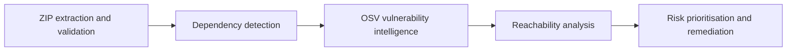

# VulnTriage

**Dependency Vulnerability Triage Agent** helps developers and security reviewers make sense of dependency vulnerability results. It scans uploaded Python, npm, Maven, and Gradle projects, checks supported resolved dependencies against [OSV.dev](https://osv.dev/), looks for static import evidence, and organizes returned findings for investigation and remediation.

## Problem and project overview

Dependency scanners can return a long list of advisories, but that list alone does not show which packages appear in source code, whether a fix is available, or which findings deserve attention first. VulnTriage brings dependency detection, OSV vulnerability lookup, basic reachability analysis, explainable risk scoring, and remediation guidance into one local Streamlit workflow.

VulnTriage is a triage aid. An import does not prove execution or exploitability, and the absence of a detected import does not prove that a dependency is unused or safe.

## Key features

- Upload a project ZIP and extract it with path, symlink, entry-count, and size checks.
- Detect dependencies from supported Python, npm, Maven, and Gradle files.
- Query OSV.dev for supported dependencies with queryable versions.
- Search source files for static Python, JavaScript/TypeScript, and Java import evidence.
- Generate risk scores, risk factors, explanations, priorities, and OSV-based remediation suggestions.
- Investigate findings in a searchable, sortable queue with severity, priority, and reachability filters.
- Review scan-wide security analytics and the dependency inventory.
- See scan coverage information when dependencies, parsing, or OSV queries are incomplete.
- Export all returned findings and their reachability evidence to CSV.

## Five-stage scan architecture

The Streamlit application extracts and validates the ZIP, then calls the orchestrator for the four agent stages:



1. **ZIP extraction and validation** checks archive paths and limits, then selects the project root when possible.
2. **Dependency detection** reads supported manifests and lockfiles. Uploaded Maven and Gradle build files are not executed.
3. **OSV vulnerability intelligence** submits supported ecosystem, package, and exact version data to OSV.dev.
4. **Reachability analysis** searches supported source files for imports that match dependencies.
5. **Risk prioritisation and remediation** combines vulnerability and reachability records, calculates a deterministic heuristic score, and provides available fix guidance.

## Supported ecosystems and project files

| Ecosystem | Dependency files | Current behavior and limits |
|---|---|---|
| Python / PyPI | `requirements.txt` | Reads requirement entries. Included `-r` and constraint files are not followed. Only versions accepted as queryable exact versions are sent to OSV; ranges and other unsupported values are not treated as exact installed versions. |
| npm | `package.json`, `package-lock.json` | Reads declared sections and lockfile package records. Yarn, pnpm, and Bun formats are not supported. |
| Maven | `pom.xml` | Reads top-level direct dependencies as `groupId:artifactId`. Simple properties declared in the same POM can be resolved; a `dependencyManagement` version is used only for a dependency that is actually declared. Management entries alone are not installed dependencies. Test and provided scopes are included. Parent-inherited and profile-activated dependencies and the full Maven transitive graph are not resolved. |
| Gradle / Maven ecosystem | `build.gradle`, `build.gradle.kts`, `gradle.lockfile` | Recognizes common literal dependency declarations and lockfile records. Lockfiles can include resolved transitive dependencies. The parser does not evaluate scripts, variables, or arbitrary Gradle expressions; unresolved and dynamic versions are not guessed. |

Vulnerability queries use OSV ecosystem names **PyPI**, **npm**, and **Maven**. Maven package names retain the exact `groupId:artifactId` coordinate. Dependency and source scanning skip generated or vendor directories including `.git`, `target`, `build`, `dist`, `node_modules`, virtual environments, and Python cache directories.

### OSV queries and scan coverage

For each supported dependency with a queryable version, VulnTriage sends the package name, ecosystem, and version to the OSV query API. Maven coordinates and Maven version strings are preserved. Missing, unresolved, ranged, dynamic, or otherwise unsupported versions are skipped rather than guessed. Failed requests do not create vulnerability findings.

The dashboard distinguishes these coverage outcomes:

- **COMPLETE** — supported dependencies were queried successfully. A successful query with no returned advisories is different from a failed query.
- **PARTIAL** — parsing failures, unsupported manifests, failed queries, or dependencies that could not be queried may have left results incomplete.
- **ALL_OSV_QUERIES_FAILED** — every detected dependency query failed, with no parsing or skipped-query issues; there is no vulnerability conclusion.
- **NO_SUPPORTED_DEPENDENCIES** — no supported dependencies were detected and OSV was not queried. This is not a clean scan.

Coverage counts include detected, successfully queried, failed, and not-queried dependencies, along with parsing failures and unsupported manifests. OSV results depend on network availability and the advisories available in the service; no returned advisory is not proof that a package is safe.

## Reachability analysis

Reachability is a static import-presence check over `.py`, `.js`, `.jsx`, `.ts`, `.tsx`, and `.java` source files. Python imports are read with Python AST. JavaScript/TypeScript import-like statements are recognized with lightweight lexical analysis. Java imports are compared against a small curated mapping:

- `com.google.guava:guava` → `com.google.common`
- `org.apache.commons:commons-lang3` → `org.apache.commons.lang3`
- `com.fasterxml.jackson.core:jackson-databind` → `com.fasterxml.jackson.databind`

Java package names are not inferred from Maven group IDs or artifact IDs. Unmapped or ambiguous Java coordinates remain `UNKNOWN`.

- **USED** — a matching static import was detected. This does not prove runtime execution or exploitability.
- **NOT_FOUND** — no matching import was detected in the relevant supported source files. This does not prove the package is unused or safe.
- **UNKNOWN** — reachability could not be determined confidently, for example because relevant source files were absent or unreadable, scanning was unreliable, or a Java mapping was unavailable or ambiguous.

Dynamic loading, reflection, plugins, indirect or transitive usage, generated runtime behavior, and unsupported source forms may not be detected. Reachability evidence is an investigation lead, not an exploitability verdict.

## Risk scoring and remediation

The deterministic risk score ranges from 0 to 100 and documents four weighted factors:

| Factor | Maximum points |
|---|---:|
| Vulnerability severity | 50 |
| Reachability | 30 |
| Fixed-version availability | 10 |
| Evidence confidence | 10 |

The **OSV severity** is the advisory severity label returned or derived from OSV data. The **VulnTriage risk level** is a band derived from the internal weighted score; it also reflects reachability, fixed-version availability, and evidence confidence. The **remediation priority** is a separate triage field based on severity and reachability: `USED` retains the severity priority, `NOT_FOUND` lowers it by one level, and unknown severity or reachability produces `UNKNOWN`. None of these values is a probability of exploitation.

Recommendations use fixed versions reported by OSV. If OSV does not report a fixed version, VulnTriage says so and advises reviewing the advisory and maintainer guidance; it does not invent a version.

## ZIP security and upload behavior

The application enforces these limits:

- **100 MB** uploaded ZIP size
- **500 MB** total expanded size
- **10,000** archive entries
- **100 MB** per extracted file

The extractor rejects traversal paths, absolute and drive-prefixed paths, backslash paths, symbolic links, encrypted entries, and duplicate normalized paths. Corrupt extraction is rejected and partial files are cleaned up. Extracted project files live in a temporary directory that is removed after the scan succeeds or fails.

Uploads are identified by SHA-256 content hash. Re-uploading identical ZIP bytes can reuse the completed result in the current Streamlit session; different contents trigger a separate scan even when the filename and file size match.

## Installation

Python 3.10 or newer is recommended. From the repository root, create a virtual environment and install runtime dependencies.

**Windows PowerShell:**

```powershell
py -3.10 -m venv .venv
.\.venv\Scripts\Activate.ps1
python -m pip install --upgrade pip
python -m pip install -r requirements.txt
```

**macOS / Linux:**

```bash
python3 -m venv .venv
source .venv/bin/activate
python -m pip install --upgrade pip
python -m pip install -r requirements.txt
```

## Run the application

From the repository root, start Streamlit:

```bash
streamlit run app.py
```

Upload a ZIP containing one or more supported projects, then select **Start Security Scan**. The dashboard retains the selected project while moving between its navigation sections.

## Dashboard navigation and CSV reports

The dashboard has four workspaces:

- **Overview** — project and scan status, upload controls, pipeline, and summary.
- **Investigation** — searchable and filterable findings plus dependency inventory and finding details.
- **Intelligence & Analytics** — scan-wide severity, risk, reachability, ecosystem, and dependency analytics.
- **Reports** — CSV download.

The CSV includes all findings returned by the scan, regardless of investigation queue search, filters, or sorting. It includes package and ecosystem identity, vulnerability and risk fields, remediation details, reachability evidence, and an interpretation of the reachability status. Use the scan coverage status to judge whether the returned findings may be incomplete; exporting every returned finding does not make an incomplete scan complete.

## Automated tests

Install pytest in the active virtual environment if it is not already available, then run:

```bash
python -m pip install pytest
python -m pytest -q
```

Latest recorded verification: **171 passed, 21 subtests passed**. Automated tests mock OSV requests with deterministic responses; they do not verify live OSV availability or current advisory contents.

## Known limitations

- Python dependency extraction reads `requirements.txt`; it does not resolve Python dependency trees or other Python manifest and lockfile formats.
- npm support does not include Yarn, pnpm, or Bun lockfiles.
- Maven extraction focuses on declared direct dependencies and does not resolve the complete Maven dependency graph. Test and provided scopes are included.
- Gradle parsing is intentionally limited to common literal declarations and lockfile records; build scripts are not evaluated.
- Java reachability uses only the three curated mappings above. Other Java dependencies generally remain `UNKNOWN`.
- Reachability does not build a call graph or prove runtime execution, vulnerable code paths, or exploitability. JavaScript/TypeScript analysis is lightweight lexical analysis rather than a complete language parser.
- OSV requests can fail, supported versions can be unavailable, and the OSV database may not contain an advisory. Check coverage and upstream advisory information before drawing conclusions.
- Risk scores, levels, priorities, and recommendations are triage guidance and should be reviewed before making remediation decisions.

## Potential future improvements (not implemented)

- Support additional Python and JavaScript package-manager manifests and lockfiles.
- Improve Maven and Gradle dependency resolution while keeping uploaded build scripts unexecuted.
- Expand Java reachability mappings only when package-to-artifact ownership is well established.
- Add deeper static usage analysis and broader integration checks against controlled fixtures.
